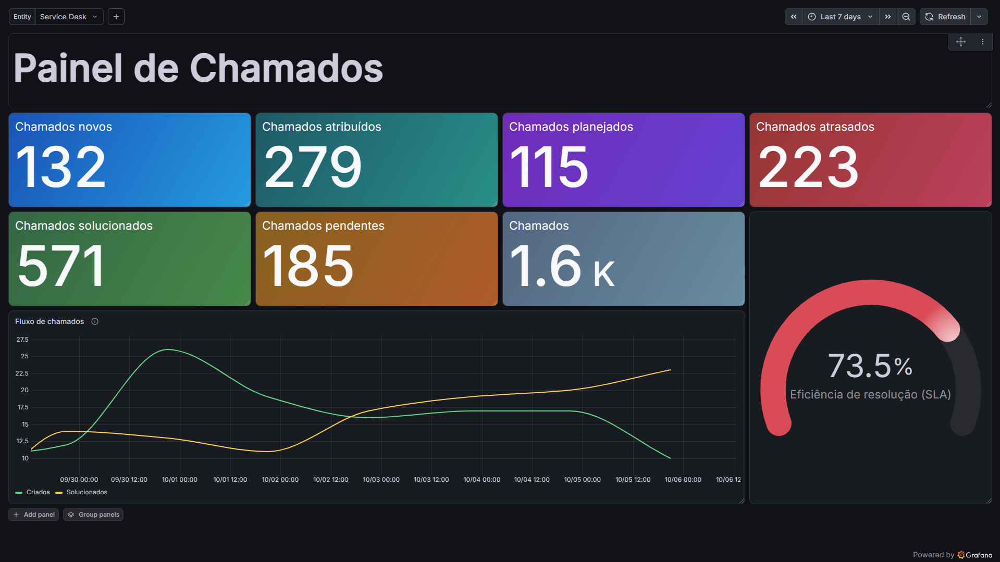

# GLPI Grafana Dashboards

**Observabilidade para operações de service desk, com SQL versionado e acesso somente de leitura ao GLPI.**

[](https://github.com/tsathler/glpi-grafana-dashboards/actions/workflows/ci.yml)

Este projeto transforma dados de chamados do GLPI em dashboards do Grafana, com consultas auditáveis, provisionamento via Docker Compose e validações automatizadas. O **GLPI Service Desk** está estável e validado em produção. O **GLPI Projects** é uma frente em desenvolvimento e ainda requer validação integrada.

## Visão geral



> **Dados de demonstração:** a imagem utiliza métricas sintéticas. Não representa dados, volumes ou informações reais da organização.

| Dashboard | Situação | O que apresenta |
| --- | --- | --- |
| **GLPI Service Desk** | **Estável e validado** | Indicadores de chamados, fluxo de criados × solucionados e eficiência de resolução por SLA/TTR |
| **GLPI Projects** | **Em desenvolvimento** | Indicadores de projetos e tarefas, progresso, Kanban e tabela operacional; validação integrada pendente |
| **Backlog** | **Planejado** | Escopo ainda não implementado |

## O problema e a abordagem

Acompanhar operações apenas pelas telas transacionais do GLPI pode dificultar uma leitura rápida de volume, fluxo e cumprimento de prazos. A proposta aqui é oferecer visualizações operacionais **sem modificar dados do sistema de origem**.

- Consultas SQL versionadas e restritas a operações read-only.
- Datasource e dashboards provisionados a partir de arquivos.
- Credenciais por ambiente em `.env` local, fora do Git.
- Pipeline de CI para verificações estáticas de configuração, consultas e arquivos.
- Documentação das métricas, decisões de segurança e limitações de compatibilidade.

## O que foi implementado

### GLPI Service Desk — estável

- Sete indicadores de estado dos chamados, com filtro por **Entity**.
- Série temporal **Fluxo de chamados**, comparando criados e solucionados.
- Gauge **Eficiência de resolução (SLA)** com base no prazo TTR do GLPI.
- Provisionamento de dashboard e datasource com SQL somente para leitura.

**Evidência:** a visualização e os indicadores do Service Desk foram conferidos na interface do GLPI e implantados em produção.

### GLPI Projects — em desenvolvimento

O MVP do dashboard e nove queries read-only estão implementados. As consultas foram verificadas diretamente no banco, mas **a validação integrada dos painéis no Grafana ainda está pendente**.

O escopo inclui métricas de projetos e tarefas, progresso, Kanban e tabela operacional. O Kanban Business Text possui estados dinâmicos e uma coluna **Sem estado**; a query adicional e os arquivos de apresentação foram versionados, mas sua validação no Grafana e contra o banco de testes permanece pendente.

Consulte [Desenvolvimento e implantação](docs/development.md) e [Marcos e roadmap](docs/milestones.md) antes de usar a frente de Projetos.

## Arquitetura

```text
Usuário autorizado
        │
        ▼
Nginx / reverse proxy
        │
        ▼
     Grafana ── SQL read-only ──► MariaDB externo do GLPI

Repositório GitHub ──► GitHub Actions ──► verificações estáticas
```

Este diagrama representa o cenário validado, não uma topologia obrigatória. O GLPI e o MariaDB ficam fora do Compose, que executa o Grafana. Outras instalações podem usar controles de acesso e reverse proxies diferentes, desde que protejam o Grafana e não exponham o banco publicamente.

## Stack e práticas

**Tecnologias:** Grafana, SQL, MariaDB/MySQL, Docker Compose, Nginx, Linux, Git e GitHub Actions.

**Segurança e qualidade:**

- Conta dedicada de banco com permissão somente de leitura.
- Nenhuma query do projeto cria ou altera objetos no banco.
- Inspeção do schema do GLPI antes da construção das métricas.
- Verificações de segurança e paridade entre SQL versionado e dashboards.
- Configuração sensível mantida fora do controle de versão.
- CI exclusivamente estática: **não** acessa o GLPI, executa consultas reais ou faz deploy.

Veja [Segurança](docs/security.md), [Arquitetura](docs/architecture.md) e [Definições das métricas](docs/metrics.md).

## Executar em ambiente próprio

**Pré-requisitos:** Linux, Git, Docker Engine e Docker Compose, além de acesso autorizado a um MariaDB do GLPI com usuário read-only.

```sh
git clone https://github.com/tsathler/glpi-grafana-dashboards.git
cd glpi-grafana-dashboards
cp .env.example .env
```

Configure o `.env` com os parâmetros do seu ambiente e as credenciais apropriadas. **Não versione esse arquivo nem reutilize credenciais administrativas do banco.**

```sh
docker compose config
docker compose up -d
```

A configuração versionada usa **host networking** e pode exigir adaptações em outros sistemas ou topologias. O runtime foi validado em Ubuntu Server 24.04 LTS. O Compose fixa a imagem `grafana/grafana:13.2.2`; outras versões não foram verificadas neste projeto.

Para instruções completas, leia [Desenvolvimento e implantação](docs/development.md). Para ajustar URLs locais dos dashboards de Projetos, veja [URL local do GLPI](docs/glpi-local-url.md).

## Validação e limitações

| Tipo | Cobertura |
| --- | --- |
| **CI / validação estática** | Compose, JSON, YAML, Markdown, SQL read-only, correspondência SQL/dashboard, arquivos de ambiente e whitespace |
| **Runtime — Service Desk** | Comparação com a interface GLPI e implantação validada |
| **Runtime — Projects** | Consultas do MVP verificadas no banco; integração dos painéis no Grafana pendente |

As consultas dependem do schema e de valores de domínio da instalação de referência. Versões, estados, relacionamentos, seleção de entidades e comportamento temporal podem variar. Antes de reutilizar o projeto, faça o discovery do banco, confira charset/collation/timezone e compare os resultados com a interface correspondente. A versão do MariaDB não é fixada pelo repositório.

## Documentação técnica

- [Arquitetura](docs/architecture.md)
- [Banco de dados e discovery](docs/database.md)
- [Definições e validação das métricas](docs/metrics.md)
- [Desenvolvimento e implantação](docs/development.md)
- [Layout do GLPI Projects](docs/projects-layout.md)
- [Segurança](docs/security.md)
- [Production Readiness](docs/production-readiness.md)
- [Marcos e roadmap](docs/milestones.md)

## Desenvolvimento com apoio de IA

Ferramentas de IA apoiaram pesquisa, implementação e documentação. A arquitetura, o SQL, a segurança, o comportamento em runtime e as métricas foram revisados manualmente e validados conforme o estado descrito acima.
